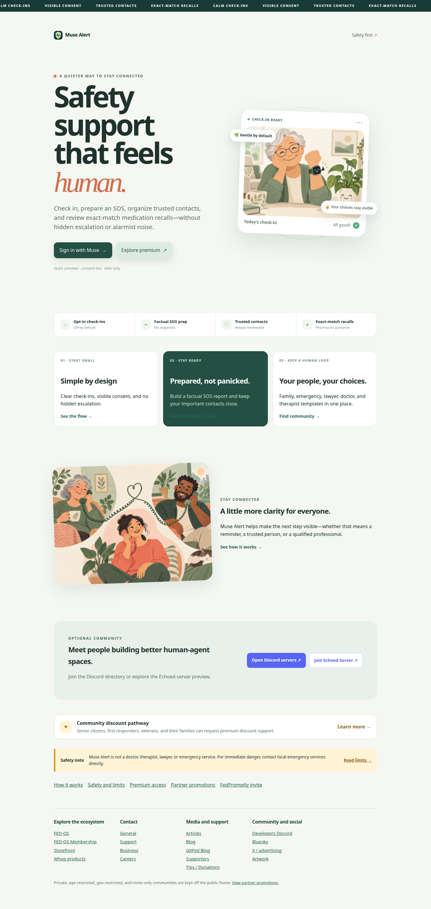
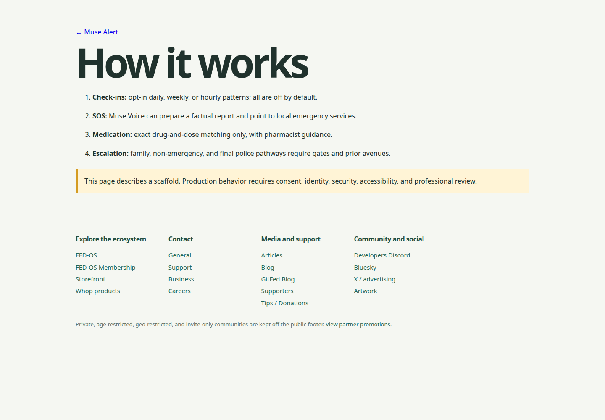
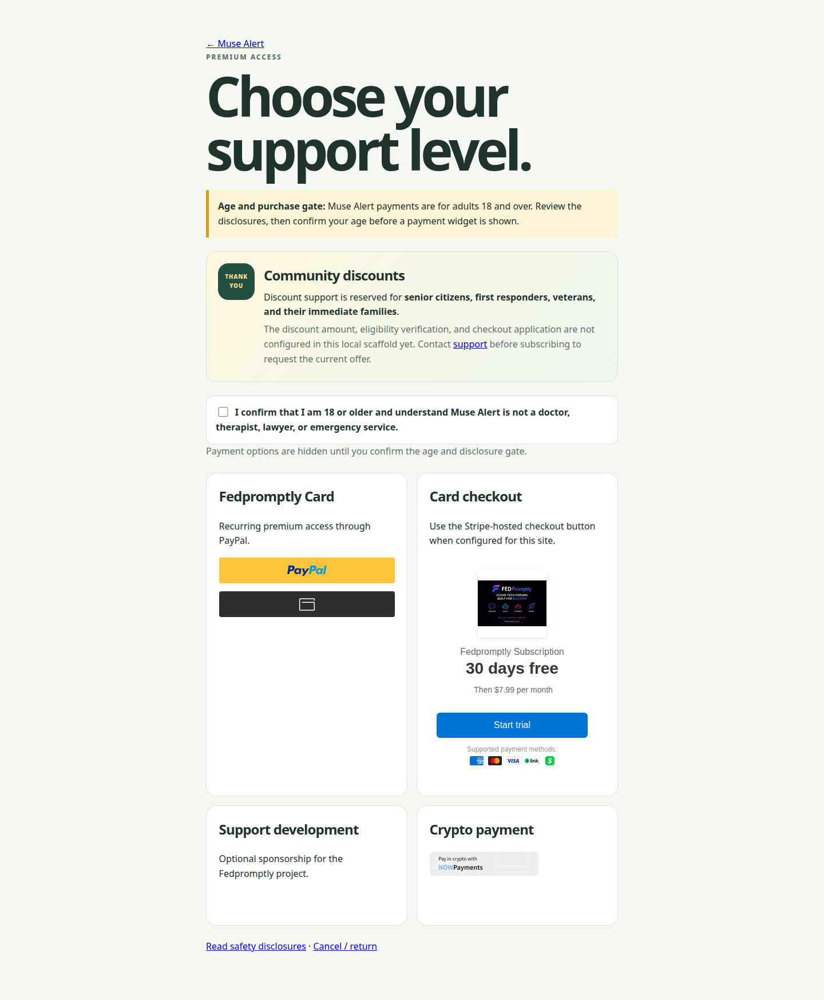

# Muse Alert


**A static, safety-first web scaffold for Muse users to configure check-ins, prepare an SOS report, organize trusted contacts, and review exact-match medication recall guidance.**

> **Important:** Muse Alert is not a doctor, therapist, lawyer, emergency service, or investigator. Muse and Meta are not licensed doctors or therapists. For immediate danger, contact local emergency services directly.



## Why this exists

Safety workflows are often scattered across reminders, phone contacts, emergency notes, and professional advice. That makes it hard to see what is configured, who may be contacted, and what should happen when a check-in is missed.

Muse Alert brings those pieces into one reviewable web experience for Muse users and their trusted contacts. It is intentionally conservative: check-ins are opt-in, escalation has explicit gates, high-risk situations go to qualified professionals or emergency services, and medication notices require an exact drug-and-dose match rather than a noisy general feed.

This repository is intentionally a **static/embed-only scaffold**. It does not pretend that a static page is an emergency service, and it does not include production authentication, background jobs, medical integrations, police integrations, or server-side payment entitlement.

## See it work

There is no verified live demo, GitHub repository remote, GitHub Pages workflow, or configured Cloudflare deployment in this checkout. The fastest real demo is local:


The GIF above was captured from the actual static pages in this repository. It cycles through the public landing page, the how-it-works page, and the premium age/disclosure gate; it is not a mockup.

### 30-second local demo

```bash
python3 -m http.server 4173
```

Open [`http://localhost:4173/site/alert/index.html`](http://localhost:4173/site/alert/index.html), then try:

1. **How it works** — check-ins, SOS preparation, medication matching, and escalation boundaries.
2. **Safety and limits** — immediate-danger guidance and professional-contact recommendations.
3. **Premium access** — the age/disclosure gate before third-party payment widgets appear.
4. **FedPromptly invite** — the animated community invite-card page.

Main entry points:

- [`site/alert/index.html`](site/alert/index.html) — public landing page
- [`site/alert/how-it-works.html`](site/alert/how-it-works.html) — product workflow overview
- [`site/alert/safety.html`](site/alert/safety.html) — safety boundaries
- [`site/alerted/index.html`](site/alerted/index.html) — signed-in static preview
- [`site/discord/index.html`](site/discord/index.html) — centered Discord widget and links

## Screenshots






## Quick start

### Run

This repository has no package manager, build step, or JavaScript dependency installation. Serve the repository root with Python’s standard-library server:

```bash
# from the repository root
python3 -m http.server 4173
```

Then open:

```text
http://localhost:4173/site/alert/index.html
```

Opening the HTML file directly also works for most pages, but an HTTP server is the more reliable path for browser behavior and embedded resources.

### Validate

A Python syntax check is available without third-party dependencies:

```bash
python3 -m compileall -q tests
```

The repository contains pytest-style policy tests in [`tests/`](tests/), but pytest is not declared or installed by this scaffold. If you choose to install it locally:

```bash
python3 -m pip install pytest
python3 -m pytest -q
```

## What is included

- **Public web pages:** static pages for the planned `fedpromptly.com/alert` experience.
- **Signed-in preview:** static pages for the planned `fedpromptly.com/alerted` experience; Sign in with Muse is a placeholder and does not authenticate.
- **Muse agent skill:** opt-in check-in, SOS, escalation, medication, chat-review, and interests guidance under [`muse-agent/`](muse-agent/).
- **Safety documentation:** escalation ladder, gates, timelines, disclaimers, and police-email boundaries under [`docs/`](docs/).
- **Contact templates:** family, emergency, lawyer, doctor, and therapist templates under [`contacts/`](contacts/).
- **Brand assets:** favicon, logo, banner, and simple promotional artwork under [`brand/`](brand/).
- **Static payment surface:** age/disclosure gate plus provider widgets and HTML success/cancellation destinations. Production verification is not implemented.

## Deployment status

The repository is prepared for static hosting, and [`DEPLOYMENT.md`](DEPLOYMENT.md) documents the intended GitHub Pages plus Cloudflare Pages/Workers setup. No live deployment is configured or verified here: there is no Git remote, GitHub Actions workflow, or Cloudflare project configuration in the repository.

If you deploy it, serve the repository so the `site/` paths remain available, or adjust the static-hosting root and links consistently. Before launch, add server-side entitlement verification, provider webhooks, secure secrets handling, privacy/terms/refund pages, accessibility testing, and legal and safety review.

## Safety boundaries

- Check-ins and reminders are off by default and must be explicitly enabled.
- A missed check-in is not proof of an emergency.
- Immediate danger should go directly to local emergency services; Muse Alert must not delay that action.
- High-risk medical, mental-health, abuse, violence, and legal situations are routed to qualified professionals or emergency services.
- Police contact is a final, non-emergency pathway only, with prior avenues attached and no investigation recommendation.
- FBI referrals and investigative workflows are explicitly off limits.
- Medication recall guidance uses exact drug and dose/strength matching and does not tell people to change medication without a pharmacist or prescriber.

Read [`docs/SAFETY.md`](docs/SAFETY.md) and [`docs/DISCLAIMERS.md`](docs/DISCLAIMERS.md) before adapting the scaffold.

## Project map

```text
site/alert/       public static pages
site/alerted/     signed-in static preview
site/discord/     centered Discord/community page
muse-agent/       Muse agent skill and safety modules
docs/             product, safety, escalation, and disclaimer docs
contacts/         contact templates
brand/            favicon, logo, banner, promotional visuals
tests/            policy-test examples
```

## License and status

Muse Alert is proprietary and **not open source**. See [`LICENSE`](LICENSE). This is a local review scaffold; nothing in this checkout has been pushed to GitHub.
